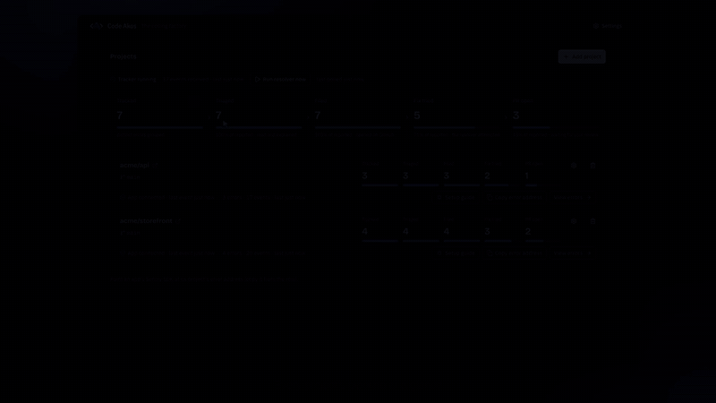
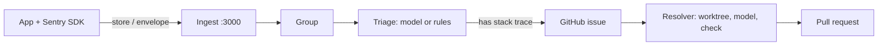

# Code Akos

Code Akos is self-hosted, Sentry-compatible error tracking. It groups the errors your app's Sentry SDK sends, opens a GitHub issue for each new one, and has an LLM attempt a fix that it opens as a pull request for you to review. The model runs locally through Ollama (default `qwen2.5-coder:7b`) or through the DeepSeek or Anthropic API.

[Watch the one-minute demo](https://ayesh96.github.io/code-akos/) (setup wizard, then an error going all the way to a pull request).

## The problem

Between an exception in production and a fix, someone has to group duplicates, write the issue, find the cause and open a pull request. Sentry automates the last steps with Seer on its paid plans, and self-hosted Sentry is a Docker Compose stack of 53 services that needs 16 GB of RAM. Code Akos covers the whole path in one Node process with SQLite, on your machine, with a model you choose.

## Install

**[Download Code Akos](https://github.com/Ayesh96/code-akos/releases/latest)** for your computer from the latest release:

| | File | First open |
|---|---|---|
| macOS, Apple Silicon (M1 and later) | `mac-arm64.dmg` | Drag Code Akos to Applications. The app is not notarized, so macOS blocks the first open: allow it in System Settings › Privacy & Security › **Open Anyway**. |
| macOS, Intel | `mac-x64.dmg` | The same. Not sure which you have? Apple menu › About This Mac: **Chip** means Apple Silicon, **Processor** means Intel. |
| Windows | `.exe` installer | The installer is unsigned, so SmartScreen warns: **More info › Run anyway**. |
| Linux | `.AppImage` | `chmod +x code-akos-*.AppImage`, then run it. |

The app brings its own runtime, so there is nothing else to install except [git](https://git-scm.com/downloads), which Code Akos uses to clone your repository and prepare fixes.

On first launch a four-step setup asks for the dashboard port and data folder, a model, and the error-tracking and resolver settings. It checks each step before you continue: the ports are free, Ollama answers, API keys are accepted, and only models the provider actually has are offered. Then the dashboard opens in its own window. To change anything later, click **Settings** in the dashboard header (or **Settings…** in the menu, ⌘, / Ctrl+,). If Code Akos will not start with the new settings, the old ones are put back.

**Models.** The setup needs at least one: [Ollama](https://ollama.com) on this machine (run `ollama pull qwen2.5-coder:7b` first, and nothing leaves your computer), or a DeepSeek or Anthropic API key (error text and source code are then sent to that provider). Pick more than one and Code Akos falls back down the list when one fails.

**Docker.** If your apps run in Docker, run Code Akos beside them from the container image: see [Running in Docker](docs/docker.md).

## First project

1. **Projects → Add project**: `owner/name`, a GitHub token, the branch to work on, and optionally a check command such as `npm ci && npm test`.
2. Set your SDK's `dsn` to the project's DSN, for example `http://codeakos@localhost:3000/1`. The project's **Setup guide** shows the code for Python, Node.js and the browser.
3. Errors appear on the project's page (**View errors** on its row). Those with a stack trace are filed as GitHub issues.

The desktop builds for Windows, Linux and Intel Macs are not tested yet; the Apple Silicon build is. On a headless server, see [running from source](docs/reference.md#running-from-source).

## Features

- **Sentry ingest.** The `store` and `envelope` endpoints, gzip, deflate or brotli bodies, and CORS for browser SDKs. You only change the DSN.
- **Grouping.** Exception type + crashing file + that frame's source line text (not its line number) or function name. Ids in the message and line-number shifts do not split a group. The SDK's `fingerprint` override is honoured.
- **Triage.** Tags each error `bot-safe`, `needs-human`, `infrastructure`, `third-party`, `no-stack-trace` or `test-event`, with a reason and a next step. Only `bot-safe` becomes a GitHub label.
- **GitHub issues.** One per new group that has a stack trace and level `error` or `fatal` (configurable). Comments when it reaches 100, 1,000 and 10,000 events.
- **Resolver.** For each open issue it filed, Code Akos fetches your branch, gives the model up to 20 tool-use turns in a throwaway worktree, runs your check command before and after, and opens a pull request marked verified or unverified. The model may answer `SKIP` instead.

The resolver does not read triage tags today: it attempts every open issue Code Akos filed, including ones tagged `needs-human` or `infrastructure`. With a paid API that costs money per attempt; a failing issue is tried at most 3 times.

## Screenshots

| Every project at a glance | What triage found | The pull request it opened |
|---|---|---|
|  |  |  |

More in [docs/assets/screenshots](docs/assets/screenshots), including the desktop setup wizard.

## How it works

Dashboard (`127.0.0.1:7420`) and ingest (`127.0.0.1:3000`) are separate sockets in one process, both on loopback by default. GitHub tokens are stored AES-256-GCM encrypted. Details: [reference](docs/reference.md).

## Compared with alternatives

| | Code Akos | Sentry | GlitchTip | Bugsink |
|---|---|---|---|---|
| Accepts Sentry SDK events | Yes | Yes | Yes | Yes |
| Self-hosted footprint | 1 Node process, SQLite | Docker Compose, 53 services incl. Kafka and ClickHouse; 4 cores, 16 GB RAM + 16 GB swap minimum | 1 service + PostgreSQL; 256 MB RAM minimum | 1 container; SQLite, MySQL or PostgreSQL |
| Creates GitHub issues | Automatically | Manually (Team plan); from alert rules (Business plan and up) | Not in its docs | Not in its docs |
| Opens fix pull requests | Yes, your model | Seer, on paid plans: $40 per active contributor per month | No | No |
| Alerts | No | Yes | Email, webhooks | Slack, Discord, Teams, Mattermost, Telegram, webhooks |
| Tracing, session replay | No | Yes | Not in its docs | Not in its docs |
| Multi-user | No | Yes | Yes | Yes |
| License | FSL-1.1-ALv2 | FSL-1.1-Apache-2.0 | MIT | Custom (see its repo) |

Facts about other tools are from their docs as of October 2026. Choose Sentry for tracing, alerting and teams. Choose GlitchTip or Bugsink for a small multi-user tracker without automated fixes. Choose Code Akos for one maintainer who wants errors turned into reviewable pull requests on their own machine.

Triage was measured on 12 replayed cases ([results](docs/TRIAGE-BEFORE-AFTER.md)). Fix success rate has not been measured.

## Roadmap

No committed roadmap. Known gaps:

- The resolver ignores triage tags (see above).
- No measured fix success rate.
- The Windows, Linux and Intel Mac desktop builds are untested, and none of the builds are signed by a recognised developer.

Bugs and ideas: [issues](https://github.com/Ayesh96/code-akos/issues).

## Contributing

See [CONTRIBUTING.md](CONTRIBUTING.md). Sign off commits (`git commit -s`) and run `npm run typecheck && npm test`.

## License

Code Akos is **source-available** under the [Functional Source License, version 1.1](LICENSE) (`FSL-1.1-ALv2`), not an OSI open-source license.

- You may **use, run, modify and self-host it**, including inside a company, for free.
- You may **not** use it to offer a competing commercial product or service.
- Each release converts to the **Apache License 2.0 two years after** it is published.

"Code Akos" is the name of this project; a fork has to use another name. To report a suspected violation, open an issue or contact the maintainer.
