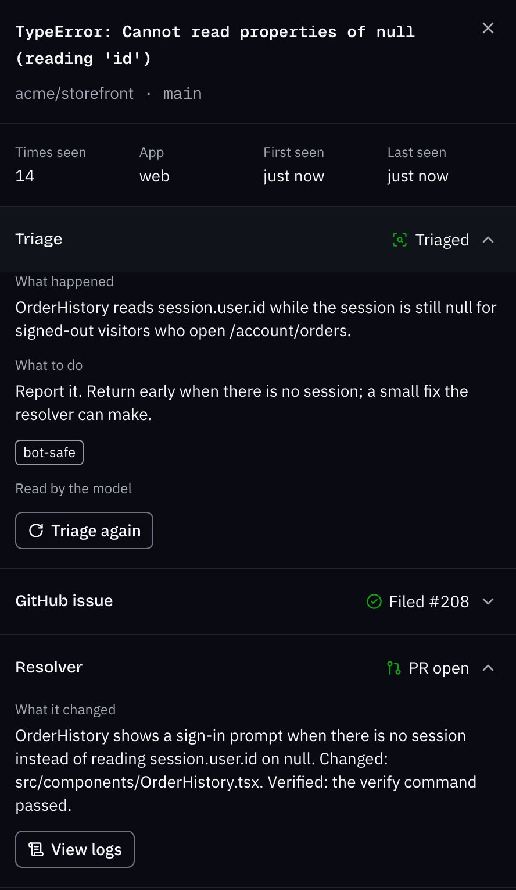
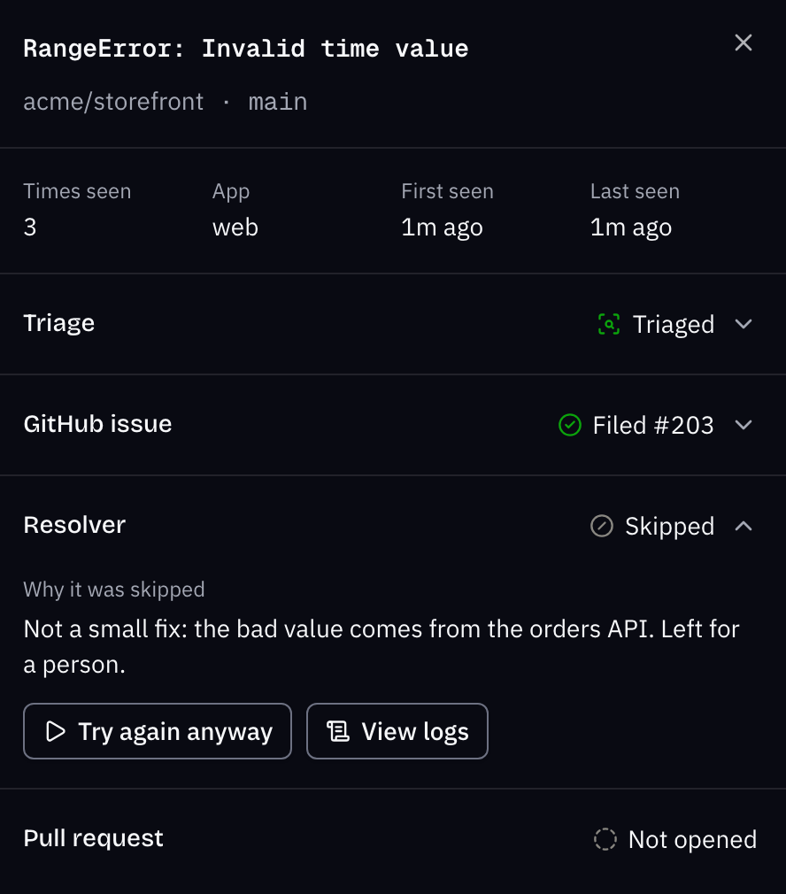
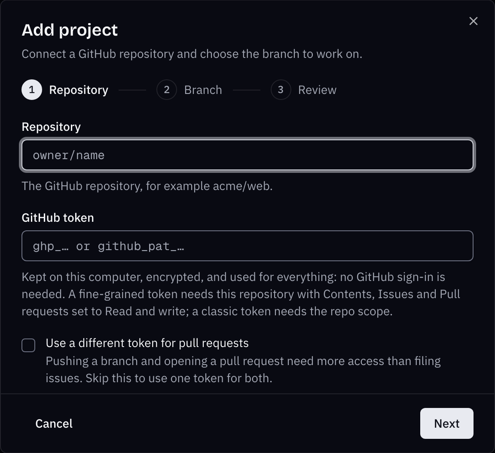
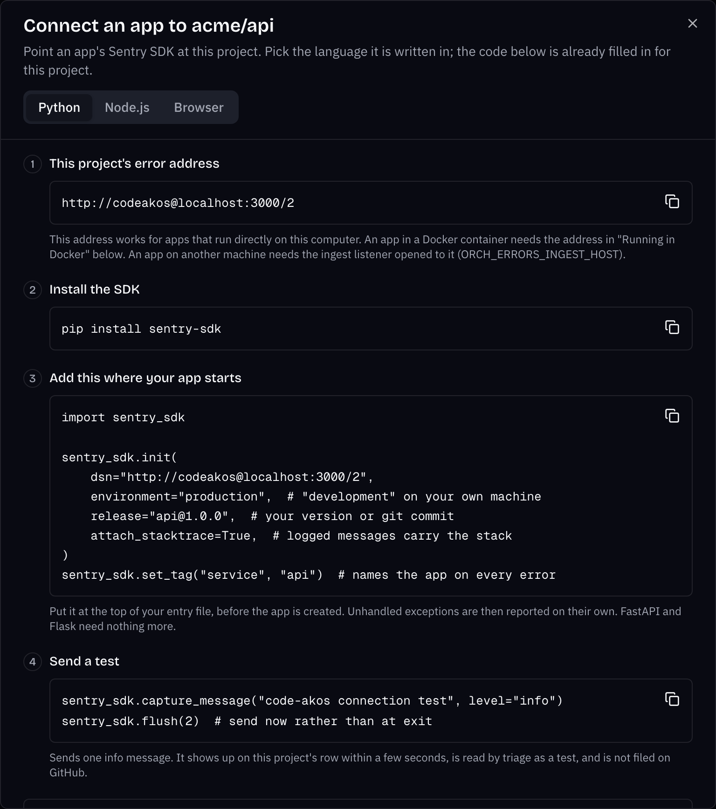

## Why Code Akos exists

When something breaks in production, the error report is only the start. Someone still has to notice it, check whether it is a duplicate, write the issue, find the line that caused it and open a pull request. For one developer or a small team, that work piles up.

Sentry can do part of it. Its AI fixes (Seer) cost $40 per active contributor per month on a paid plan, and its own self hosted package is a Docker Compose stack of 53 services that wants 16 GB of RAM and 16 GB of swap. Code Akos is one desktop app with a SQLite database. You keep your Sentry SDK and change one setting, the DSN. You choose the model: Ollama on your machine, or the DeepSeek or Anthropic API.

## How an error becomes a pull request

-   1. Receive

    Your app's Sentry SDK sends errors to Code Akos instead of sentry.io. Code Akos accepts the same requests, so you change only the DSN.

-   2. Group

    Repeats count as one error. The group is the exception type, the crashing file and the text of the crashing line, so a user ID in the message does not start a new group.

-   3. Triage

    The model writes what happened and what to do, and adds tags such as `bot-safe` for a small fix or `infrastructure` for a database that is down.

-   4. File an issue

    By default, each new error with a stack trace at level error or fatal becomes one GitHub issue. Code Akos comments again at 100, 1,000 and 10,000 events.

-   5. Open a pull request

    The resolver edits a throwaway copy of your branch and runs your check command before and after. It opens a pull request marked verified or unverified. Code Akos never merges anything.

-   Or skip, with a reason

    The model can answer `SKIP` and say why, for example when the bad value comes from another service. You can ask it to try again.

## What it looks like

-   { loading=lazy width="888" height="1530" }

    **One error, start to finish.** Triage, the GitHub issue and the pull request, in one panel.

-   { loading=lazy width="888" height="1010" }

    **A skipped fix, explained.** The bad date comes from the orders API, so guarding the formatter would only hide the problem.

-   { loading=lazy width="1152" height="1056" }

    **Adding a project.** A repository, a GitHub token and the branch to work on.

-   { loading=lazy width="1536" height="1736" }

    **Connecting an app.** Code for Python, Node.js and the browser, with your project's DSN filled in.

For a full tour, see [using the dashboard](usage.md).

## Quick start

[Download Code Akos](https://github.com/Ayesh96/code-akos/releases/latest){ .md-button .md-button--primary data-ff-download="1" } [All releases](https://github.com/Ayesh96/code-akos/releases){ .md-button }

| Your computer | File to download |
|---|---|
| Mac with Apple silicon (M1 or newer) | `mac-arm64.dmg` |
| Mac with an Intel processor | `mac-x64.dmg` |
| Windows | `.exe` installer |
| Linux | `.AppImage` |

1. **Install the app** and [git](https://git-scm.com/downloads). The builds are unsigned, so your system asks you to confirm the first time you open the app. The [installation guide](installation.md) shows how on each system.
2. **Pick a model** in the setup window: [Ollama](https://ollama.com) to keep your code on your machine, or a DeepSeek or Anthropic API key.
3. **Add a project.** Enter your GitHub repository, a token and the branch to work on.
4. **Point your Sentry SDK at Code Akos** by setting its `dsn` to the address Code Akos gives you, such as `http://codeakos@localhost:3000/1`.

The [getting started guide](getting-started.md) covers steps 3 and 4 with code for Python, Node.js and the browser.

## Is Code Akos right for you?

It fits if you maintain an app alone or in a small team, use GitHub, and want errors turned into pull requests you review, without paying per seat or running a large server.

Look elsewhere if you need tracing, session replay, alert rules or accounts for a whole team. Sentry covers all of these. GlitchTip and Bugsink are lighter trackers that several people can share. The [comparison with Sentry, GlitchTip and Bugsink](sentry-alternative.md) has the details.

## Limits you should know about

* **The fix success rate is not measured.** Triage was measured on 12 replayed cases ([results](TRIAGE-BEFORE-AFTER.md)). Fixes have not been. Review every pull request as you would one from a new contributor.
* **The resolver ignores triage tags.** It tries every open issue Code Akos filed, including ones tagged `needs-human` or `infrastructure`. On a paid API each attempt costs money, and an issue that fails is tried at most 3 times. Close an issue to keep the resolver off it.
* **The check command is not sandboxed.** It runs through `sh -c` in the working copy, after the model has edited the code. It has your user's permissions and the environment of the Code Akos process, which includes your model API keys.
* **The builds are unsigned.** The Windows, Linux and Intel Mac builds are also untested. Only the Apple silicon build has been tested.
* **It is a tracker for one person.** There are no alerts, no tracing, no session replay and no user accounts.

## Guides

-   [**Installation**](installation.md)

    Download, first launch and the setup on macOS, Windows and Linux.

-   [**Getting started**](getting-started.md)

    Add your first project, connect your app and follow an error to a pull request.

-   [**Using the dashboard**](usage.md)

    Projects, the error list, triage results, fixes and settings.

-   [**Sentry alternatives compared**](sentry-alternative.md)

    Code Akos, Sentry, GlitchTip and Bugsink side by side.

-   [**AI bug fixes as pull requests**](ai-bug-fix-pull-requests.md)

    How the resolver chooses issues, what the model can do and what it costs.

-   [**FAQ**](faq.md)

    Licensing, privacy, supported SDKs and how Code Akos differs from Sentry Seer.

## License

Code Akos is source available under the [Functional Source License](https://github.com/Ayesh96/code-akos/blob/main/LICENSE) (`FSL-1.1-ALv2`). That is not an open source license. You can use, change and host it yourself for free, including at work. You cannot use it to offer a competing commercial product or service. Each release becomes Apache 2.0 licensed two years after it is published.
