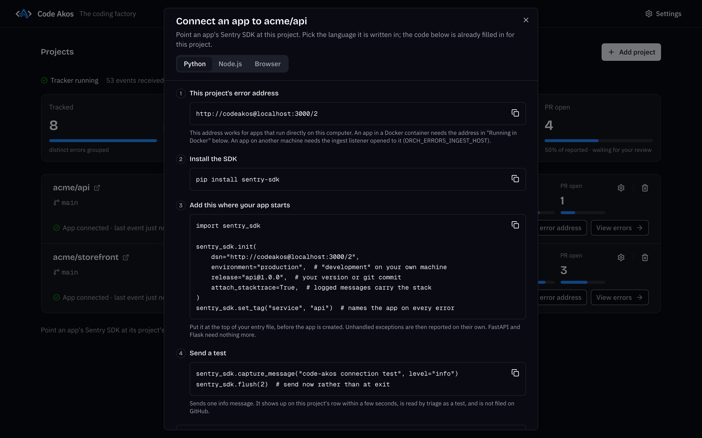

## Why Code Akos exists

When something breaks in production, the error report is only the start. Someone still has to notice it, check whether it is a duplicate, write up an issue, find the line that caused it and open a pull request with the fix. For a solo developer or a small team, that work piles up.

Sentry can automate part of it, but its AI fixes (Seer) are a paid add-on, and running Sentry yourself means a Docker Compose stack of 53 services that needs 16 GB of RAM. Code Akos does the whole job in a single desktop app with a SQLite database. You keep your existing Sentry SDK, change one setting (the DSN), and choose which model writes the fixes: one running on your own machine through Ollama, or DeepSeek or Anthropic through their APIs.

## How an error becomes a pull request

-   1. Receive

    Your app's Sentry SDK sends errors to Code Akos instead of sentry.io. Code Akos speaks the same protocol, so the only change in your code is the DSN.

-   2. Group

    Repeats of the same error are counted as one. Grouping uses the exception type, the file and the line of code that crashed, so a changing user ID in the message does not create a new group.

-   3. Triage

    The model reads the error and the stack trace, writes down what happened and what to do, and tags it, for example `bot-safe` for a small fix or `infrastructure` for a database that is down.

-   4. File an issue

    Each new error with a stack trace becomes one GitHub issue. Code Akos comments on it again when it has happened 100, 1,000 and 10,000 times.

-   5. Open a pull request

    The model edits a temporary copy of your repository. Your test command runs before and after the change, and the fix is opened as a pull request for you to review. Code Akos never merges anything.

-   Or explain why not

    When the cause is outside your code, such as an API sending bad data or a missing secret, the model says so and skips the fix instead of guessing.

## What it looks like

-   { loading=lazy width="2880" height="1800" }

    **Every project at a glance.** How many errors were tracked, triaged, filed, attempted and turned into pull requests.

-   { loading=lazy width="2880" height="1800" }

    **What happened and what to do.** Triage names the culprit file and line and suggests the next step.

-   { loading=lazy width="2880" height="1800" }

    **A skipped fix, explained.** The bad date comes from the orders API, so guarding the formatter would only hide the problem.

-   { loading=lazy width="2880" height="1800" }

    **Connecting an app.** Copy-ready setup code for Python, Node.js and the browser, with your project's DSN filled in.

For a full tour, see [using the dashboard](usage.md).

## Quick start

[Download Code Akos](https://github.com/Ayesh96/code-akos/releases/latest){ .md-button .md-button--primary data-ff-download="1" } [All releases](https://github.com/Ayesh96/code-akos/releases){ .md-button }

| Your computer | File to download |
|---|---|
| Mac with Apple silicon (M1 or newer) | `mac-arm64.dmg` |
| Mac with an Intel processor | `mac-x64.dmg` |
| Windows | `.exe` installer |
| Linux | `.AppImage` |

1. **Install the app** and [git](https://git-scm.com/downloads). The builds are not signed yet, so your system asks you to confirm the first time you open the app. The [installation guide](installation.md) shows how on each system.
2. **Pick a model** in the setup window: [Ollama](https://ollama.com) to keep everything on your machine, or a DeepSeek or Anthropic API key.
3. **Add a project.** Enter your GitHub repository, a token and the branch to work on.
4. **Point your Sentry SDK at Code Akos** by setting its `dsn` to the address Code Akos gives you, such as `http://codeakos@localhost:3000/1`.

The [getting started guide](getting-started.md) walks through steps 3 and 4 with screenshots and code for Python, Node.js and the browser.

## Is Code Akos right for you?

Code Akos is a good fit if you maintain an app on your own or in a small team, use GitHub, and want errors turned into reviewable pull requests without paying per seat or running a large server.

Look elsewhere if you need performance tracing, session replay, alert rules or accounts for a whole team. Sentry covers all of these, and GlitchTip and Bugsink are lighter multi-user trackers. The [comparison with Sentry, GlitchTip and Bugsink](sentry-alternative.md) goes into the details.

## Guides

-   [**Installation**](installation.md)

    Download, first launch and the four-step setup on macOS, Windows and Linux.

-   [**Getting started**](getting-started.md)

    Add your first project, connect your app and follow an error all the way to a pull request.

-   [**Using the dashboard**](usage.md)

    Projects, the error list, triage results, fixes and settings.

-   [**Sentry alternatives compared**](sentry-alternative.md)

    Code Akos, Sentry, GlitchTip and Bugsink side by side.

-   [**AI bug fixes as pull requests**](ai-bug-fix-pull-requests.md)

    How the fixer chooses issues, what the model can do and what it costs.

-   [**FAQ**](faq.md)

    Licensing, privacy, supported SDKs and how Code Akos differs from Sentry Seer.

## Current limits

Code Akos tracks errors only. It has no performance tracing, session replay or alert rules, and it is built for one person: there are no user accounts. The Apple silicon build is tested; the Windows, Linux and Intel Mac builds are not yet. How often the AI fixes are correct has not been measured, so review every pull request as you would one from a new contributor.

Code Akos is source-available under the [Functional Source License](https://github.com/Ayesh96/code-akos/blob/main/LICENSE) (FSL-1.1-ALv2). You can use and self-host it for free, including at work, and each release becomes Apache 2.0 licensed two years after it is published.
