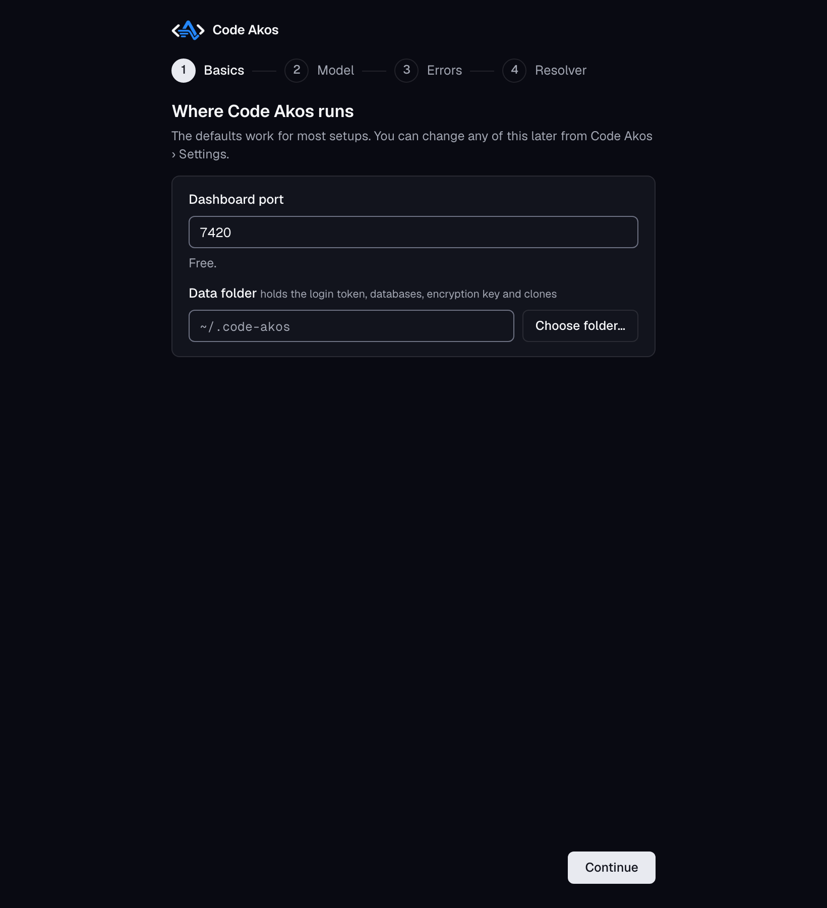
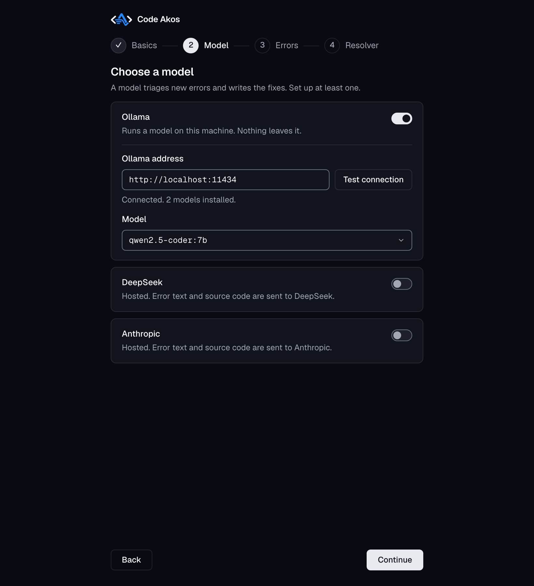
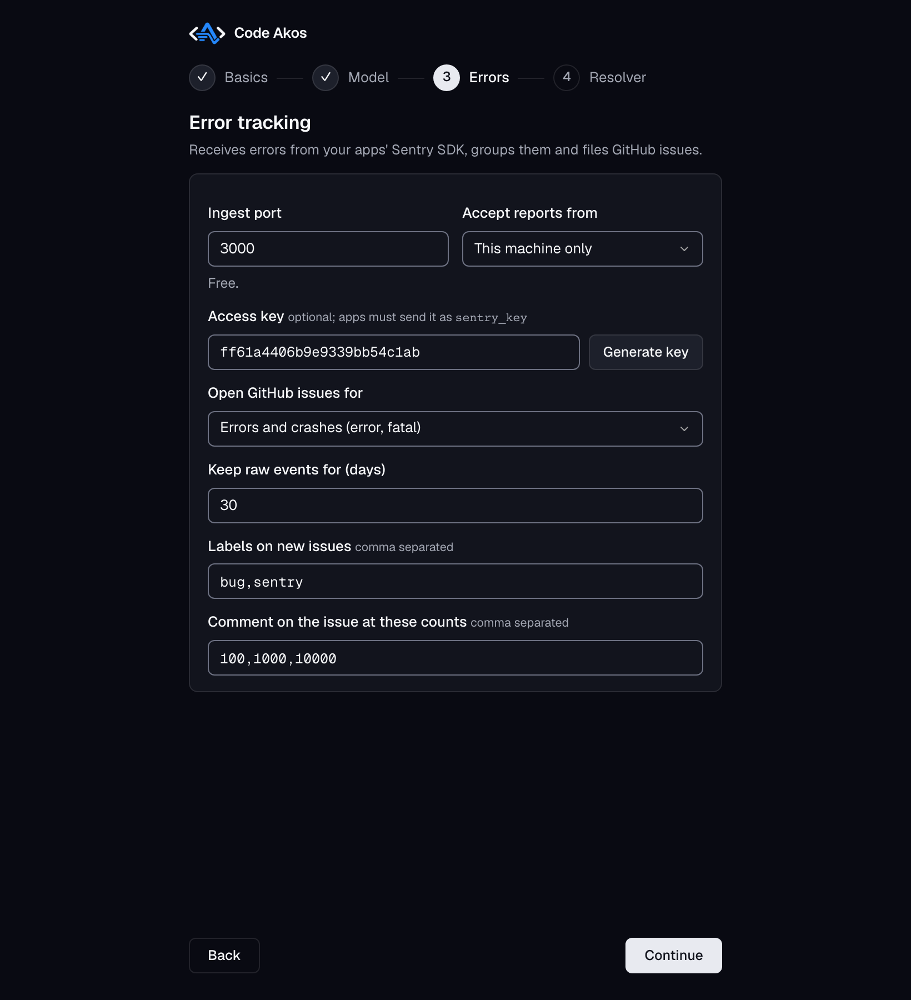
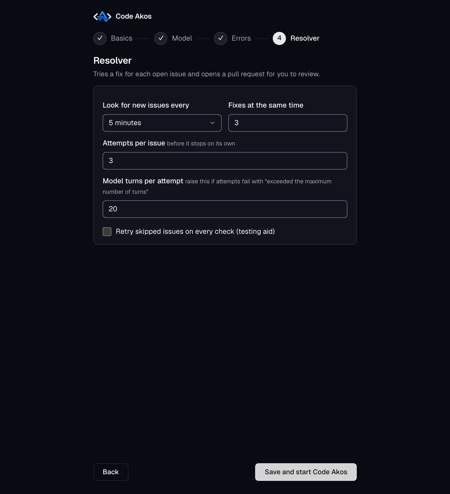

# Installation

Code Akos is a desktop app for macOS, Windows and Linux. It includes everything it needs to run, so you do not need to install Node.js, Docker or a database. This page covers downloading the app, opening it the first time and the short setup that follows. When you are done, continue with [getting started](getting-started.md) to connect your first app.

## What you need

- **A computer running macOS, Windows or Linux.** The Apple silicon Mac build is the one tested so far. The Windows, Linux and Intel Mac builds are produced the same way but have not been tested yet; please [open an issue](https://github.com/Ayesh96/code-akos/issues) if something goes wrong.
- **[git](https://git-scm.com/downloads).** Code Akos uses it to copy your repository and prepare fixes. On a Mac, running `git --version` in Terminal offers to install it if it is missing.
- **A GitHub repository** for the app you want to monitor, and permission to create a token for it.
- **A model** to read errors and write fixes. You can use either of these:
    - [Ollama](https://ollama.com), which runs a model on your own computer. Nothing is sent to anyone else, and there is no per use cost.
    - An API key from [DeepSeek](https://platform.deepseek.com) or [Anthropic](https://console.anthropic.com). These usually give better fixes, but error details and parts of your source code are sent to that provider, and each call is billed.

## Download

Download the file for your computer from the [latest release on GitHub](https://github.com/Ayesh96/code-akos/releases/latest).

| Your computer | File | Example name |
|---|---|---|
| Mac with Apple silicon (M1, M2, M3, M4 or newer) | `mac-arm64.dmg` | `code-akos-<version>-mac-arm64.dmg` |
| Mac with an Intel processor | `mac-x64.dmg` | `code-akos-<version>-mac-x64.dmg` |
| Windows 10 or 11 | `.exe` installer | `code-akos-<version>-win-x64.exe` |
| Linux | `.AppImage` | `code-akos-<version>-linux-x86_64.AppImage` |

!!! tip "Which Mac do I have?"
    Open the Apple menu and choose **About This Mac**. If you see a line called **Chip** (for example "Apple M2"), you have Apple silicon. If it says **Processor** (for example "Intel Core i7"), you have an Intel Mac.

## Open Code Akos for the first time

The builds are not yet signed with a paid developer certificate, so macOS and Windows warn you the first time you open the app. This is expected. Here is how to get past it on each system.

### macOS

1. Open the `.dmg` file and drag **Code Akos** into the **Applications** folder.
2. Open Code Akos from Applications. macOS says it cannot check the app for malicious software. Click **Done** (or **Cancel**).
3. Open **System Settings**, go to **Privacy & Security** and scroll down to the security section. Click **Open Anyway** next to the message about Code Akos, then confirm with your password.
4. Code Akos opens. From now on it opens normally.

### Windows

1. Run the `.exe` installer.
2. Windows SmartScreen shows "Windows protected your PC". Click **More info**, then **Run anyway**.
3. Follow the installer. Code Akos starts when it finishes and appears in the Start menu.

### Linux

1. Make the file executable: `chmod +x code-akos-*.AppImage`
2. Run it: `./code-akos-*.AppImage`

Some distributions need FUSE to run AppImages. If you see an error about `libfuse.so.2`, install your distribution's `libfuse2` package (named `libfuse2t64` on Ubuntu 24.04).

## Set up a model

Do this before going through the setup, because the setup checks that the model is reachable.

=== "Ollama (on your computer)"

    1. Install Ollama from [ollama.com](https://ollama.com) and start it.
    2. Download the default model in a terminal:

        ```bash
        ollama pull qwen2.5-coder:7b
        ```

    Any model you have pulled is offered in the setup, so you can use a larger or smaller one if it suits your computer better.

=== "DeepSeek or Anthropic (API)"

    Create an API key in the [DeepSeek platform](https://platform.deepseek.com) or the [Anthropic Console](https://console.anthropic.com). You paste it into the setup, which checks it before saving. The defaults are `deepseek-flash` and `claude-haiku-4-5`, both inexpensive models.

You can set up more than one. Code Akos uses them in order and moves to the next one if a call fails.

## The setup window

The first time Code Akos opens, a setup window asks four questions. Each step is checked before you can continue: ports must be free, Ollama must answer, API keys must be accepted and only models your provider actually offers are listed. The defaults work for most people.

### Step 1: Basics

{ loading=lazy width="1640" height="1800" }

- **Dashboard port** is where the Code Akos dashboard runs on your computer. The default is `7420`.
- **Data folder** holds Code Akos's databases, the encryption key for your GitHub tokens and the copies of your repositories. The default is `~/.code-akos` (a hidden folder in your home folder). Back it up and protect it like your SSH keys.

### Step 2: Model

{ loading=lazy width="1640" height="1800" }

Switch on the providers you set up above. For Ollama, click **Test connection**; Code Akos lists the models you have installed and you pick one. For DeepSeek and Anthropic, paste your API key and choose a model. At least one provider is required.

### Step 3: Errors

{ loading=lazy width="1640" height="1800" }

- **Ingest port** is where your apps send their errors. The default is `3000`.
- **Accept reports from** decides who can send errors. Keep **This machine only** while you try Code Akos. Choose **Any machine on the network** when your app runs on a different computer or server, and put a reverse proxy with HTTPS in front if the traffic leaves your local network.
- **Access key** is optional. If you set one, apps must include it in their DSN, so strangers cannot send you errors.
- **Open GitHub issues for** sets the lowest level that gets an issue. The default, *errors and crashes*, skips warnings and info messages. Those are still stored and shown in the dashboard.
- **Keep raw events for** sets how many days individual error reports are kept. Totals and issues are kept regardless.
- **Labels on new issues** are added to every GitHub issue Code Akos opens.
- **Comment on the issue at these counts** makes Code Akos post an update when an error keeps happening.

### Step 4: Resolver

{ loading=lazy width="1640" height="1800" }

The resolver is the part that writes fixes.

- **Look for new issues every** sets how often it checks for issues to work on. The default is 5 minutes.
- **Fixes at the same time** limits how many it works on at once.
- **Attempts per issue** is how many times it retries an issue that failed before giving up. It waits 15 minutes after the first failure and twice as long after each one after that.

Click **Save and start Code Akos**. The dashboard opens in its own window.

## Change the settings later

Click **Settings** at the top right of the dashboard, or use the menu (**Code Akos › Settings…** on macOS, **File › Settings…** on Windows and Linux, shortcut ⌘, or Ctrl+,). The same four steps open with your current values. When you save, Code Akos restarts. If it cannot start with the new settings, your previous settings are put back automatically.

The settings are kept in a file outside the app, so they survive updates:

| System | Settings file |
|---|---|
| macOS | `~/Library/Application Support/Code Akos/.env` |
| Windows | `%APPDATA%\Code Akos\.env` |
| Linux | `~/.config/Code Akos/.env` |

## Update Code Akos

The desktop app checks for a new version shortly after it starts and then once a day. When there is one, it asks you: **Download** opens the file for your computer in your browser, **Later** asks again next time, and **Skip This Version** stays quiet until the version after it.

Install the download over the old app, the same way as the first time. Your settings, projects and error history are kept.

To check yourself, use **Check for Updates…** (in the **Code Akos** menu on macOS, the **Help** menu on Windows and Linux). Untick **Automatically Check for Updates** in the same menu to stop the daily check. You can always download a new version from the [releases page](https://github.com/Ayesh96/code-akos/releases/latest).

## Uninstall

Delete the app, then delete the data folder (`~/.code-akos` unless you changed it) and the settings folder from the table above. Issues and pull requests already on GitHub are not affected.

## Run Code Akos on a server

The desktop app is the easiest way to run Code Akos on your own computer. To run it on a headless Linux server instead, install Node.js 24 or newer and git, then run it from source:

```bash
git clone https://github.com/Ayesh96/code-akos.git && cd code-akos
npm install
npm start
```

The first `npm start` runs the same setup in the terminal. See [running from source](reference.md#running-from-source) for the prebuilt release tarball and other details.

## Troubleshooting

**The setup says a port is in use.** Another program is using that port. Pick another number, such as `7421` for the dashboard or `3001` for ingest.

**Ollama does not connect.** Check that Ollama is running (`ollama list` in a terminal should answer) and that the address is `http://localhost:11434`.

**No models are listed for Ollama.** You have not downloaded one yet. Run `ollama pull qwen2.5-coder:7b`, then click **Test connection** again.

**macOS still refuses to open the app.** Make sure you dragged it into Applications first, then use **Open Anyway** in System Settings › Privacy & Security as described above.

Still stuck? [Open an issue](https://github.com/Ayesh96/code-akos/issues) with your system and what you see.

## Next step

[Getting started](getting-started.md): add your first project and send it an error.
