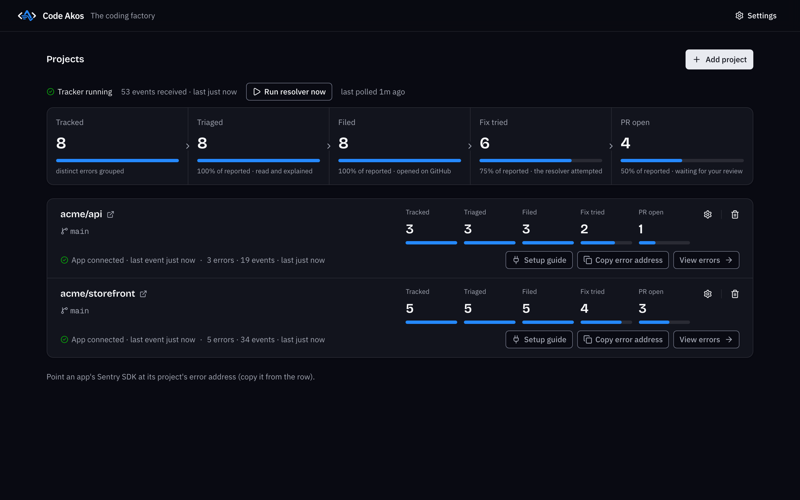
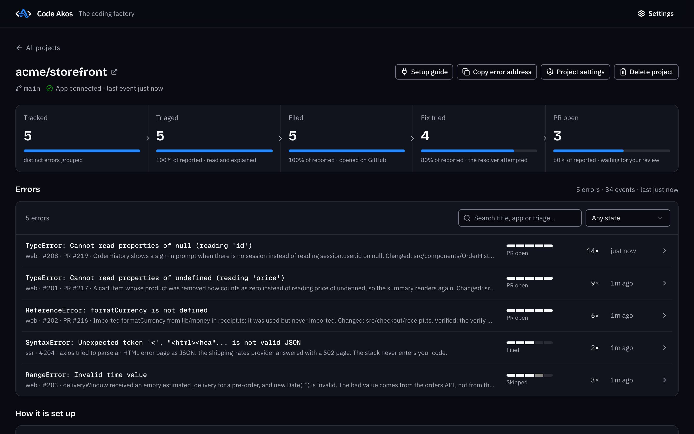
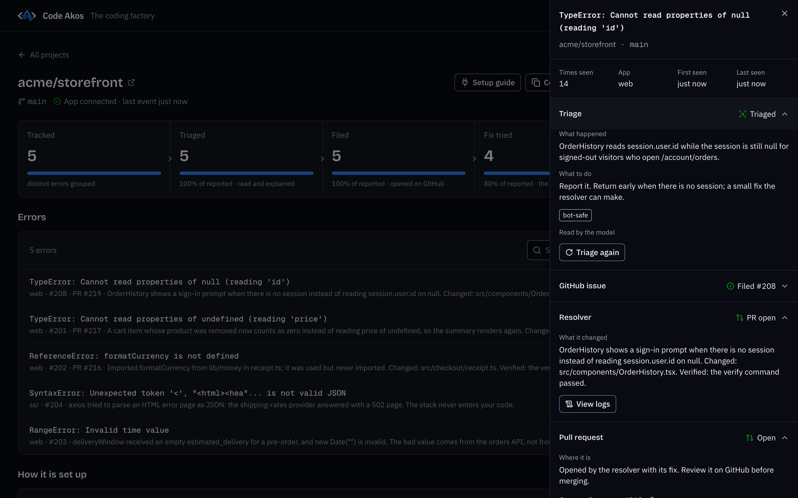
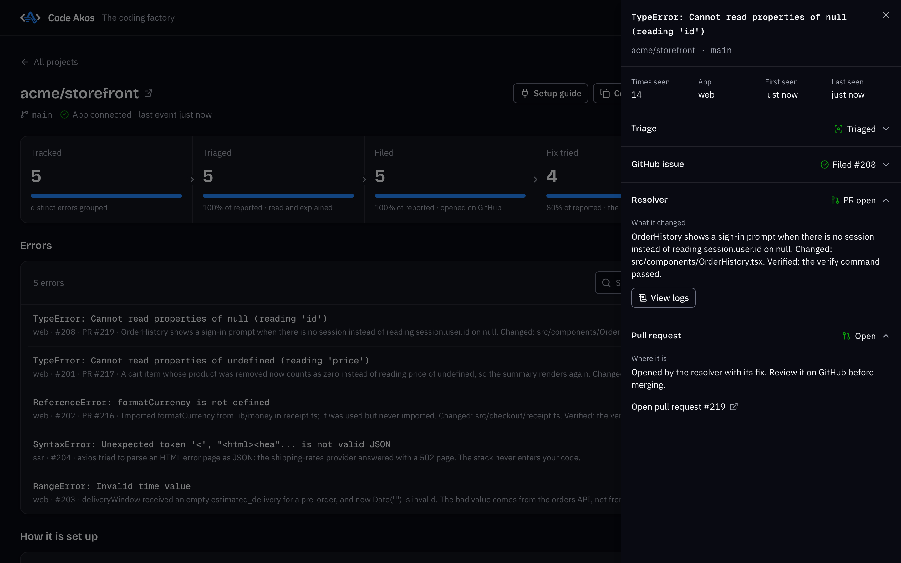
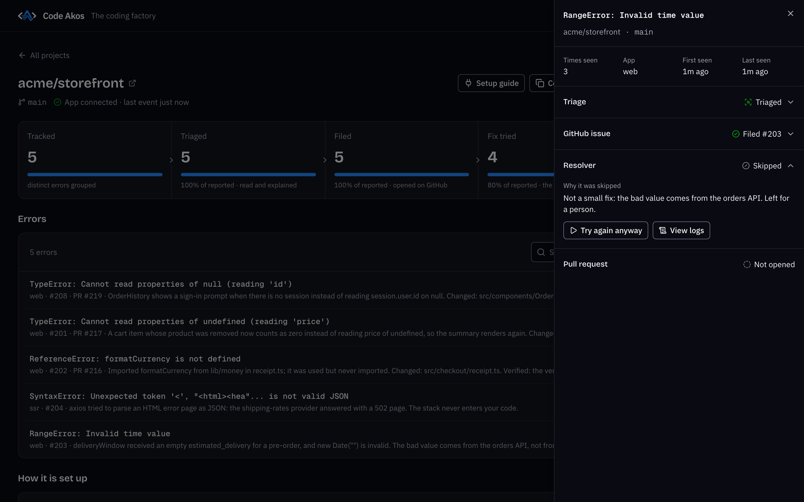

# Using the dashboard

The dashboard is where you see every error your apps report and what Code Akos did about it. This page walks through each screen. If you have not added a project yet, start with [getting started](getting-started.md).

## The five stages

Every error moves through up to five stages, and the dashboard counts how many reached each one:

| Stage | What it means |
|---|---|
| **Tracked** | Code Akos received the error and grouped it with any repeats. |
| **Triaged** | A model (or the built-in rules) read it and explained it. |
| **Filed** | It was opened as an issue on GitHub. |
| **Fix tried** | The resolver attempted a fix. |
| **PR open** | The fix is waiting for your review as a pull request. |

An error can stop early on purpose. A warning or an error without a stack trace is tracked and triaged but not filed, and the resolver can decide to skip an error whose cause is not in your code.

## Projects overview

{ loading=lazy width="2880" height="1800" }

The **Projects** page is the first thing you see.

- **Tracker running** confirms that Code Akos is accepting errors, with the number received and when the last one arrived.
- **Run resolver now** starts a round of fixes immediately instead of waiting for the next scheduled check (every 5 minutes by default). Next to it is the time of the last check.
- The **totals row** adds up the five stages across all projects.
- Each **project row** shows its repository and branch, its own five stages, whether an app is connected and when the last event arrived, and how many errors and events it has. **View errors** opens the project page.
- On the right of each row, **Setup guide** shows the SDK code for connecting an app, and **Copy error address** copies the project's DSN.
- The gear icon opens the project's settings, and the bin icon deletes it.

## A project's errors

{ loading=lazy width="2880" height="1800" }

The project page lists every error group, most recently seen first. Each row shows:

- the exception and its message, for example `TypeError: Cannot read properties of null (reading 'id')`;
- the app it came from, the GitHub issue and pull request numbers, and a one-line summary of the latest finding;
- a small five-step track showing how far it got, with its current state underneath;
- how many times it happened and when it was last seen.

Use the **search box** to find errors by title, app or triage text. The **state filter** narrows the list to:

| Filter | Shows |
|---|---|
| Any state | Everything |
| Not filed | Errors that were not opened on GitHub, such as warnings and errors without a stack trace |
| bot-safe | Errors triage considers a small fix in your own code |
| Fix in progress | Errors the resolver is working on |
| PR open | Errors with a pull request waiting for you |
| Skipped or failed | Errors the resolver skipped or could not fix |

Below the list, **How it is set up** shows the project's repository copy, its token (the last four characters), the fix check (the command run before and after each fix), the apps reporting to it (their `service` tag), its error address, and whether errors without a stack trace are filed on GitHub.

## Error details

Click an error to open its details on the right. The top shows how many times it was seen, which app sent it, and when it was first and last seen. Below that is one section per stage. The section where the error currently is opens by default.

### Triage

{ loading=lazy width="2880" height="1800" }

- **What happened** explains the error in plain words and names the file and line where it started.
- **What to do** suggests the next step.
- **Tags** sort the error. `bot-safe` means a small fix in your own code. Others are `needs a person`, `infrastructure` (a network, permission or configuration problem), `third-party code` (the crash is entirely inside a library), `no stack trace` and `test event`. The [triage guide](local-llm-error-triage.md) explains each one.
- **Read by the model** or **Read by built-in rules** tells you which produced the result.
- **Triage again** runs triage once more, for example after you switch to a better model.

### GitHub issue

Shows the issue number and links to it on GitHub. The issue holds the full stack trace, the environment and release, and your SDK's tags. Local variables and request bodies are never written to the issue.

### Resolver and pull request

{ loading=lazy width="2880" height="1800" }

When the resolver has made a fix, **What it changed** describes the change, lists the files and says whether your check command passed. **Open pull request** takes you to it on GitHub. Review it there and merge or close it as you would any pull request.

### When a fix is skipped

{ loading=lazy width="2880" height="1800" }

The resolver skips an error when the cause is outside your code, when your check command already fails before any change, or when it is not sure what the right fix is. **Why it was skipped** gives the reason. In this example, the bad date comes from another service, so guarding the code that formats it would only hide the problem.

If you disagree, click **Try again anyway** to run the resolver on it once more. When an attempt fails instead, **What went wrong** explains it. A failed error is retried automatically up to the limit you set (3 by default).

## Project settings

Open a project's settings with the gear icon on its row, or with **Project settings** on its page. You can change:

- **Branch to work on.** Changing it fetches the new branch. New fixes start from it.
- **GitHub token.** Leave it empty to keep the saved one. A new token is checked with GitHub before it is saved.
- **Token for pull requests.** An optional second token used only to push branches and open pull requests.
- **Command to check a fix.** Run before and after every fix, for example `npm ci && npm test`.
- **Also file errors without a stack trace on GitHub.** Off by default, because a bare log line gives the fixer little to work with.

Changes apply from the next fix attempt. **Delete project** removes the project, its saved token and its copy of the repository. Your GitHub repository, its issues and your apps are not touched.

## App settings

**Settings** at the top right reopens the setup window with your current values: ports, data folder, models, error tracking and the resolver. See [installation](installation.md#the-setup-window) for what each option does. Saving restarts Code Akos, and if the new settings do not work, the previous ones are restored.

## Next steps

- [AI bug fixes as pull requests](ai-bug-fix-pull-requests.md): how the resolver chooses and attempts fixes.
- [Configuration reference](reference.md): every setting, including those not in the setup window.
